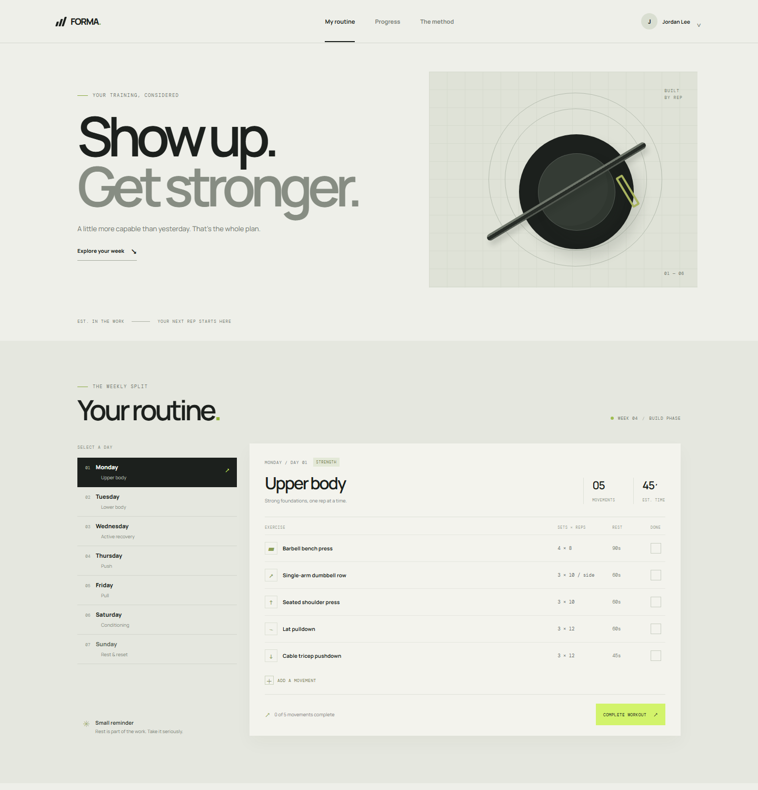
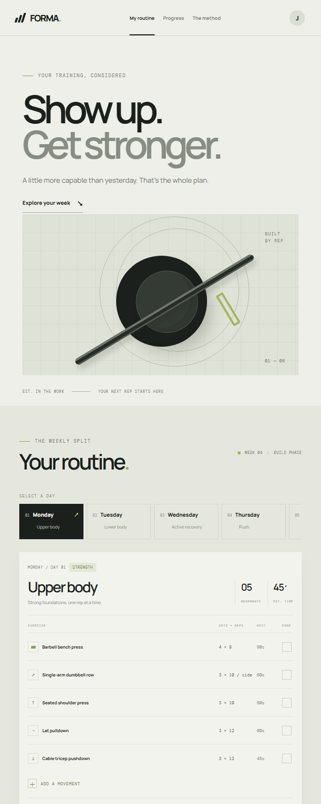

# FORMA Gym Routine

A responsive weekly workout planner with day-by-day routines, exercise check-offs, and a simple training progress view.

## Screenshots

### Desktop



### Mobile



## Features

- Seven-day training split with strength, conditioning, recovery, and rest sessions.
- Check off movements or complete a full workout.
- Add custom movements to any day with sets, reps, and rest time.
- Custom movements are saved in the current browser using local storage.
- Responsive layout for desktop and smaller screens.

## Run locally

Open `index.html` in a browser, or serve the project directory:

```sh
python -m http.server 8000
```

Then visit <http://localhost:8000>.
